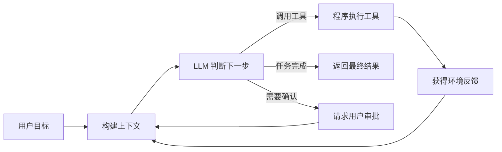

---
tags:
  - ai
---
# Agent 开发

## 1. 什么是 Agent 开发

Agent 开发不是训练一个新的大模型，而是把现有大模型作为决策组件，连接外部工具、业务数据和运行状态，使系统能够围绕目标持续采取行动，并根据环境反馈决定下一步。

可以把 Agent 抽象为：

```text
Agent = LLM + Context + Tools + Loop + State + Evaluation + Guardrails
```

其中：

- **LLM**：理解目标、推理并决定下一步行动。
- **Context**：提供当前任务真正需要的信息。
- **Tools**：让模型能够读取数据、调用 API 或改变外部系统。
- **Loop**：反复执行“判断、行动、观察”，直到任务完成。
- **State**：保存任务进度、会话状态和历史经验。
- **Evaluation**：判断结果是否正确、稳定并值得上线。
- **Guardrails**：限制权限、风险、费用和运行范围。

Agent 开发的核心不是“让模型多说几轮”，而是设计一个可靠的软件系统，让不完全确定的大模型可以安全地参与决策和执行。

## 2. Agent 的基本运行循环



典型执行过程如下：

1. 用户给出目标。
2. 程序组装系统指令、任务状态、相关记忆和可用工具。
3. 模型决定直接回答还是调用工具。
4. 程序校验参数并执行工具。
5. 工具结果作为新的观察信息返回给模型。
6. 模型根据结果继续行动、请求确认或结束任务。

真正的 Agent 必须具备明确的停止条件，例如任务完成、达到最大循环次数、超过费用预算、操作需要用户授权或者发生不可恢复错误。

## 3. Agent 的核心组成部分

### 3.1 LLM 与模型调用

大模型是 Agent 的决策组件，但不是整个 Agent。

程序员需要理解：

- System Prompt、User Message 和 Tool Message 的作用。
- Token、上下文窗口、温度和模型能力差异。
- Structured Output 和 JSON Schema。
- Function Calling 或 Tool Calling。
- 流式输出、并发、限流、延迟和调用费用。
- 如何根据任务复杂度选择不同模型。

目标不是研究模型内部的全部数学原理，而是能够稳定地把模型接入程序，并得到可验证、可解析的输出。

### 3.2 Context Engineering

模型只能根据当前上下文做决定。Agent 的效果很大程度取决于程序选择了什么信息，而不只是 Prompt 写得是否漂亮。

Context Engineering 包括：

- 系统指令和任务约束。
- 当前任务状态和已完成步骤。
- 工具定义及工具使用示例。
- 从知识库检索出来的相关资料。
- 历史操作、错误信息和用户反馈。
- 上下文压缩、摘要和过期信息清理。

Context Engineering 的目标是在有限的上下文窗口中提供足够、相关、可信的信息，同时避免无关内容干扰模型。

### 3.3 Tools 与 MCP

工具让 Agent 从“生成文字”升级为“执行任务”。工具可以是：

- Java 方法或本地函数。
- HTTP API。
- 数据库查询。
- 搜索、浏览器和文件系统。
- Shell、代码执行环境。
- 企业内部业务系统。
- 另一个 Agent 或专用模型。

一个合格的 Agent 工具需要具备清晰的名称、用途说明、参数 Schema、返回结构和错误信息。高风险工具还需要权限控制、参数校验、幂等性、超时、审计和人工审批。

MCP（Model Context Protocol）用于标准化 Agent 与工具、资源和外部系统之间的连接。学习 MCP 主要包括：

- MCP Client 与 MCP Server。
- Tools、Resources 和 Prompts。
- stdio、Streamable HTTP 等传输方式。
- 工具发现、过滤和按需加载。
- 身份认证、权限和生命周期管理。

MCP 解决的是连接标准化问题，不能替代良好的 API、工具描述和安全设计。

### 3.4 Loop、Workflow 与 Orchestration

Loop 决定 Agent 如何反复调用模型和工具。Orchestration 决定多个步骤、函数或 Agent 如何协作。

常见模式包括：

- **Prompt Chaining**：上一步输出作为下一步输入。
- **Routing**：根据任务类型选择不同处理路径。
- **Parallelization**：同时处理彼此独立的子任务。
- **Orchestrator-Workers**：动态拆分任务并交给多个执行单元。
- **Evaluator-Optimizer**：生成结果后持续评价和改进。
- **Human-in-the-loop**：在关键节点请求人工判断或审批。

步骤固定、规则明确的业务适合 Workflow；步骤无法提前确定，需要模型根据环境动态决策的任务才适合 Agent。

### 3.5 State、Memory 与 RAG

这三个概念经常被混用：

- **State**：当前任务执行到哪里，例如待办步骤、工具结果、审批状态。
- **Memory**：跨步骤或跨会话保存的信息，例如用户偏好、历史经验和失败教训。
- **RAG**：从外部知识库检索资料，并加入模型上下文。

Memory 可以进一步划分为：

- **短期记忆**：当前会话和当前任务的信息。
- **长期记忆**：跨会话保留的用户、业务和经验信息。
- **情景记忆**：过去发生过什么。
- **语义记忆**：已经确认的事实和知识。
- **程序性记忆**：可重复执行的方法、流程和技能。

聊天记录不等于完整的 Memory，向量数据库也不等于 Memory。真正的记忆系统还需要决定写入什么、何时检索、如何更新、何时遗忘以及如何处理冲突。

### 3.6 Evaluation

传统程序通常可以通过确定性断言测试，而 Agent 的输出和执行路径存在概率性，因此必须建立专门的评估体系。

常见评估内容包括：

- 最终任务是否完成。
- 答案或操作结果是否正确。
- 工具选择和参数是否合理。
- 是否违反权限和业务规则。
- 执行步骤、延迟和 Token 成本。
- 同一任务重复运行时是否稳定。
- 修改 Prompt、模型或工具后是否出现回归。

评估通常需要真实任务集、完整执行轨迹、确定性检查器，以及必要时的人工评价或 LLM-as-Judge。没有评估体系，Agent 开发就只能依靠人工试用和主观感觉。

### 3.7 Guardrails 与生产可靠性

Agent 会自主选择工具，因此必须对它的能力边界进行限制。

需要关注：

- Prompt Injection 和恶意内容。
- 工具最小权限和工具白名单。
- 文件、Shell 和代码执行沙箱。
- 写操作、付款、删除等高风险操作审批。
- 密钥、隐私数据和租户隔离。
- 超时、重试、熔断、限流和最大循环次数。
- 日志、Tracing、审计和执行回放。
- Checkpoint、任务中断和恢复。
- Token 预算、缓存和模型路由。

Agent 的模型能力决定能力上限，可靠性工程决定它能否真正上线。

## 4. Agent 与相关概念的区别

| 概念 | 核心特征 | 是否自主决定执行路径 |
| --- | --- | --- |
| 聊天机器人 | 根据输入生成回答 | 通常否 |
| RAG 应用 | 检索资料后生成回答 | 通常否 |
| Workflow | 按代码预先定义的路径执行 | 否 |
| Agent | 根据目标和环境反馈动态选择工具与步骤 | 是 |
| Multi-Agent | 多个 Agent 分工、通信和协作 | 是 |
| 自动化脚本 | 按确定性规则执行操作 | 否 |

这些概念不是互斥关系。一个 Agent 可以使用 RAG、执行 Workflow，也可以把另一个 Agent 当作工具。Multi-Agent 只是复杂任务的一种架构方案，并不天然优于单 Agent。

## 5. 程序员学习 Agent 的知识范围

### 5.1 必须掌握

- 大模型 API 和模型基本特性。
- Prompt 与 Context Engineering。
- Structured Output 和 Tool Calling。
- Agent Loop 和停止条件。
- 工具设计、错误处理和权限控制。
- MCP Client 与 MCP Server。
- RAG、State 和 Memory 的区别与实现。
- Workflow 和常用编排模式。
- Evaluation、Tracing 和回归测试。
- 安全、成本、延迟和生产可靠性。

### 5.2 后续按需学习

- 多 Agent 协作。
- 浏览器和计算机操作 Agent。
- 代码执行沙箱。
- 模型网关和多模型路由。
- Agent Skills 和技能库。
- 长期任务调度与分布式 Agent Runtime。
- 领域模型微调和强化学习。

### 5.3 应用开发前期不必深入

- 从头训练基础大模型。
- CUDA 和大规模分布式训练。
- Transformer 的完整数学推导。
- RLHF、DPO 等训练算法细节。
- 同时掌握大量 Agent 框架。
- 没有明确需求的复杂 Multi-Agent 架构。

对大多数传统程序员而言，“转型 Agent”通常是转向 Agent 应用工程或平台工程，而不是直接转型为大模型算法研究员。

## 6. Agent 相关岗位方向

| 方向 | 主要工作 | 重点知识 |
| --- | --- | --- |
| Agent 应用工程 | 把模型接入具体业务并完成任务闭环 | Tool Calling、RAG、Workflow、Evaluation、业务集成 |
| Agent 平台工程 | 建设通用 Agent Runtime 和基础设施 | 模型网关、MCP、状态存储、沙箱、调度、可观测性 |
| Agent 算法工程 | 改进模型推理、规划和学习能力 | Python、PyTorch、Transformer、SFT、强化学习 |

传统后端工程师最自然的方向是 Agent 应用工程或 Agent 平台工程。已有的 API、数据库、分布式系统、权限、安全、日志和故障处理经验仍然有效，而且是 Agent 从演示走向生产的重要能力。

## 7. Java 与 Spring AI 的技术对应关系

Java 程序员不需要为了开发 Agent 完全转向 Python。Spring AI 已经覆盖大部分 Agent 应用开发能力：

| Agent 能力 | Spring AI 对应能力 |
| --- | --- |
| 模型调用 | `ChatModel`、`ChatClient` |
| Structured Output | Structured Output Converter |
| 工具定义 | `@Tool`、`ToolCallback` |
| 工具调用循环 | `ToolCallingAdvisor`、`ToolCallingManager` |
| 会话记忆 | `ChatMemory`、`ChatMemoryRepository` |
| RAG | `VectorStore`、`QuestionAnswerAdvisor` |
| 请求拦截与扩展 | Advisors API |
| MCP | MCP Client、MCP Server、MCP Boot Starter |
| 可观测性 | Spring AI Observability |

学习时最好先手动实现一次模型与工具之间的循环，理解 Agent 的运行机制，再使用框架自动管理循环。Python 可以作为阅读示例、运行实验和编写评测脚本的补充语言。

## 8. 常见误区

### 8.1 Agent 就是复杂 Prompt

Prompt 只是 Agent 的一部分。没有工具、状态、循环和环境反馈的系统，通常只是一个大模型应用。

### 8.2 RAG 就是 Agent

RAG 负责检索知识，Agent 负责根据目标动态决策和执行。RAG 可以是 Agent 的一个组件。

### 8.3 Agent 越自主越好

自主性会增加成本、延迟和风险。能够使用确定性代码解决的步骤，应优先使用普通程序或 Workflow。

### 8.4 多 Agent 一定比单 Agent 强

多 Agent 会引入通信、状态同步、错误传播和额外成本。只有任务确实可以分工，并且收益经过评估验证时才值得采用。

### 8.5 掌握框架就等于掌握 Agent

框架会变化，但工具调用循环、上下文管理、状态、评估和可靠性问题长期存在。应先理解机制，再选择框架。

### 8.6 Demo 能运行就可以上线

生产 Agent 必须处理权限、审计、失败恢复、成本、注入攻击和评估回归。能跑通只说明完成了原型。

## 9. 参考资料

- [Anthropic: Building Effective Agents](https://www.anthropic.com/engineering/building-effective-agents)
- [Anthropic: Code execution with MCP](https://www.anthropic.com/engineering/code-execution-with-mcp)
- [Microsoft Agent Framework Overview](https://learn.microsoft.com/en-us/agent-framework/overview/)
- [Spring AI: Building Effective Agents](https://docs.spring.io/spring-ai/reference/api/effective-agents.html)
- [Spring AI: Tool Calling](https://docs.spring.io/spring-ai/reference/api/tools.html)
- [Spring AI: Advisors API](https://docs.spring.io/spring-ai/reference/api/advisors.html)
- [Model Context Protocol Documentation](https://modelcontextprotocol.io/docs/getting-started/intro)
