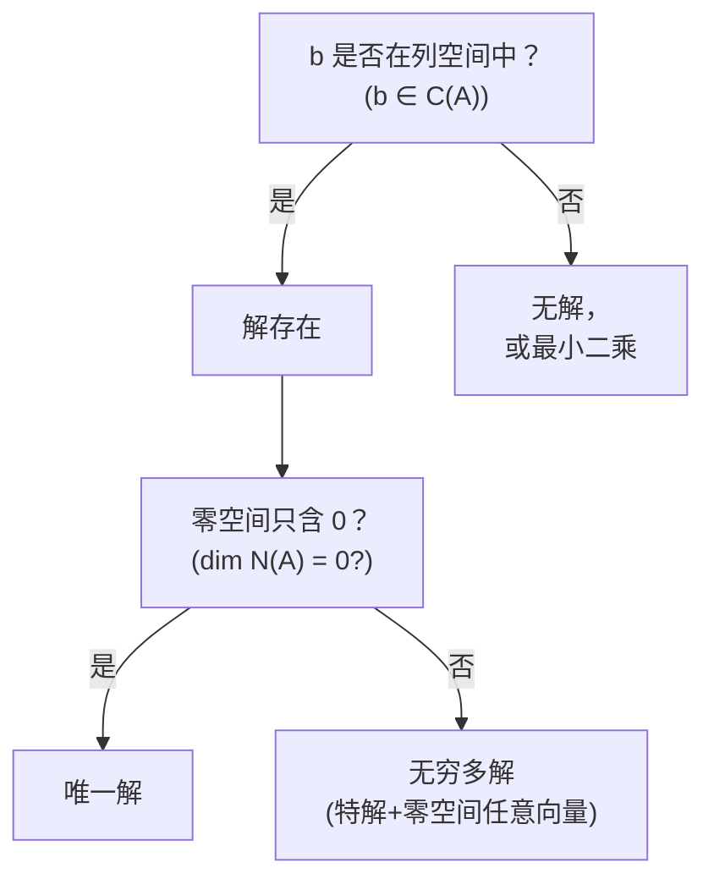

---
tags:
  - math
  - linear-algebra
---

# 四个基本子空间

关联笔记：[[线性代数绪论]]、[[向量空间]]、[[分量数]]

---

## 一张表速查

设 $A$ 是 $m \times n$ 矩阵（**m** 行，**n** 列）。

| 子空间      | 记法                                  | 属于                             | 维度                    |
| -------- | ----------------------------------- | ------------------------------ | --------------------- |
| **行空间**  | Row Space / $C(A^{\mathsf T})$      | $\mathbb{R}^{\color{red}{n}}$  | $\color{red}{r}$      |
| **零空间**  | Nullspace / $N(A)$                  | $\mathbb{R}^{\color{red}{n}}$  | $\color{red}{n - r}$  |
| **列空间**  | Column Space / $C(A)$               | $\mathbb{R}^{\color{teal}{m}}$ | $\color{teal}{r}$     |
| **左零空间** | Left Nullspace / $N(A^{\mathsf T})$ | $\mathbb{R}^{\color{teal}{m}}$ | $\color{teal}{m - r}$ |

> **$r$ = 秩（rank）** = 主元的个数 = 行空间/列空间的维度。

---

## 形式化定义

设 $A \in \mathbb{R}^{m \times n}$（$m$ 行 $n$ 列），则 $A$ 定义了四个基本子空间：

### 1. 行空间（Row Space）
$$
\boxed{\text{Row}(A) = C(A^{\mathsf T}) = \{ \mathbf{y} \in \mathbb{R}^n \mid \mathbf{y} = A^{\mathsf T} \mathbf{x},\; \mathbf{x} \in \mathbb{R}^m \}}
$$

- $A$ 的 $m$ 个行向量（每个 $\in \mathbb{R}^n$）张成的空间
- 等价定义：$\text{Row}(A) = \text{span}\{ \text{row}_1(A), \text{row}_2(A), \dots, \text{row}_m(A) \}$
- 也等于 $A^{\mathsf T}$ 的列空间

### 2. 列空间（Column Space）
$$
\boxed{\text{Col}(A) = C(A) = \{ \mathbf{b} \in \mathbb{R}^m \mid \mathbf{b} = A \mathbf{x},\; \mathbf{x} \in \mathbb{R}^n \}}
$$

- $A$ 的 $n$ 个列向量（每个 $\in \mathbb{R}^m$）张成的空间
- 等价定义：$\text{Col}(A) = \text{span}\{ \text{col}_1(A), \text{col}_2(A), \dots, \text{col}_n(A) \}$
- 也是 $A\mathbf{x} = \mathbf{b}$ 有解时所有 $\mathbf{b}$ 的集合

### 3. 零空间（Nullspace / Kernel）
$$
\boxed{N(A) = \{ \mathbf{x} \in \mathbb{R}^n \mid A\mathbf{x} = \mathbf{0} \}}
$$

- 齐次方程 $A\mathbf{x} = \mathbf{0}$ 的**所有解**构成的集合
- 包含零向量（$\mathbf{x} = \mathbf{0}$ 平凡解）
- 当 $A$ 列满秩（$r = n$）时，$N(A) = \{ \mathbf{0} \}$

### 4. 左零空间（Left Nullspace）
$$
\boxed{N(A^{\mathsf T}) = \{ \mathbf{y} \in \mathbb{R}^m \mid \mathbf{y}^{\mathsf T} A = \mathbf{0}^{\mathsf T} \} = \{ \mathbf{y} \in \mathbb{R}^m \mid A^{\mathsf T} \mathbf{y} = \mathbf{0} \}}
$$

- 左乘 $A$ 得零的行向量（转置后为列向量）
- 等价于 $A^{\mathsf T} \mathbf{y} = \mathbf{0}$ 的解空间
- 反映 $A$ 的行向量之间的**线性关系**

> **四个子空间之间的关系**：行空间与零空间正交且互为正交补（在 $\mathbb{R}^n$ 中），列空间与左零空间正交且互为正交补（在 $\mathbb{R}^m$ 中）。详见下文。

---

## 理解归属的核心逻辑

### 原则：看"这个子空间里的向量有几个分量"

**行空间 ← 看列数 $n$**

```
A = [行1 ⟶ a₁₁ a₁₂ ... a₁ₙ]
    [行2 ⟶ a₂₁ a₂₂ ... a₂ₙ]
```

每一行有 $n$ 个数字 → 每个行向量在 $\mathbb{R}^n$ 里 → 行空间 $\subseteq \mathbb{R}^n$。

**列空间 ← 看行数 $m$**

$$
A = \begin{bmatrix}
\vdots & \vdots & & \vdots \\
c_1 & c_2 & \cdots & c_n \\
\vdots & \vdots & & \vdots
\end{bmatrix}
\quad\text{每列有 }m\text{ 个数字}
$$

每一列有 $m$ 个数字 → 每个列向量在 $\mathbb{R}^m$ 里 → 列空间 $\subseteq \mathbb{R}^m$。

**零空间 ← 看 $\mathbf{x}$ 的[[分量数]] $n$**

$$
\underbrace{A}_{m\times n} \underbrace{\mathbf{x}}_{n\times 1} = \mathbf{0}
$$

$\mathbf{x}$ 必须有 $n$ 个分量才能乘 → $\mathbf{x} \in \mathbb{R}^n$ → 零空间 $\subseteq \mathbb{R}^n$。

> ❓ **等等**：$\mathbf{x}$ 是**列向量**，而行空间的行是**行向量**，两者怎么都在 $\mathbb{R}^n$？
>
> ✅ $\mathbb{R}^n$ 是"所有 $n$ 元数组的集合"，**不区分书写格式**：
> $\begin{bmatrix}x_1\\ \vdots\\ x_n\end{bmatrix},\quad [\,x_1\;\cdots\;x_n\,],\quad (x_1,\dots,x_n)$
>
> 这三个是同一个向量的不同写法，都在 $\mathbb{R}^n$ 里。行/列的格式区别只是为了**矩阵乘法能算**，而不是空间的本质区别。

**左零空间 ← 看 $\mathbf{y}$ 的[[分量数]] $m$**

$$
\mathbf{y}^{\mathsf T} A = \mathbf{0}^{\mathsf T}
\quad\Longleftrightarrow\quad
\underbrace{A^{\mathsf T}}_{n\times m} \underbrace{\mathbf{y}}_{m\times 1} = \mathbf{0}
$$

$\mathbf{y}$ 必须有 $m$ 个分量 → $\mathbf{y} \in \mathbb{R}^m$ → 左零空间 $\subseteq \mathbb{R}^m$。

---

## 维度公式：为什么是 $r$、$n-r$、$m-r$？

这四个维度加起来正好 **$n + m$**，不是巧合：

| 子空间 | 维度 | 解释 |
|-------|------|------|
| 行空间 | $r$ | 有 $r$ 个主元行，它们线性无关，张成行空间 |
| 零空间 | $n - r$ | $n$ 个未知数，$r$ 个主元列确定 $r$ 个"约束"，剩下 $n-r$ 个自由变量 |
| 列空间 | $r$ | 有 $r$ 个主元列，它们线性无关，张成列空间 |
| 左零空间 | $m - r$ | $m$ 行中有 $r$ 个主元行，剩下 $m-r$ 行是"冗余"的 |

### 理解零空间的维度 $n - r$

解 $A\mathbf{x} = \mathbf{0}$ 时：

- $n$ 个未知数
- $r$ 个**主元列**对应的变量被"固定"（用自由变量表示）
- 剩下 $n - r$ 个**自由变量** → 可以自由赋值 → 零空间有 $n - r$ 个维度

> 自由变量就是零空间的"遥控器"——每个自由变量对应零空间的一个维度。

### 理解左零空间的维度 $m - r$

左零空间是 $A^{\mathsf T}\mathbf{y} = \mathbf{0}$ 的解空间。$A^{\mathsf T}$ 是 $n \times m$ 矩阵，秩仍为 $r$。

所以：
- 未知数 $\mathbf{y}$ 有 $m$ 个
- 主元列数 = $r$
- 自由变量 = $m - r$

> 左零空间的维数 $m - r$ 也可以理解为：矩阵 $A$ 的**行之间有多少个线性关系**。

---

## Strang 经典的"四格图"

```
            ℝⁿ                    ℝᵐ
      ┌──────────────┐      ┌──────────────┐
      │  行空间      │      │  列空间      │
      │  dim = r     │ ——→  │  dim = r     │
      │              │  A   │              │
      └──────────────┘      └──────────────┘
              ⟂                      ⟂
      ┌──────────────┐      ┌──────────────┐
      │  零空间      │      │  左零空间    │
      │  dim = n-r   │ ←——  │  dim = m-r   │
      │              │  Aᵀ  │              │
      └──────────────┘      └──────────────┘
```

核心关系：

$$
\boxed{
\begin{aligned}
&\text{行空间 } \perp \text{ 零空间} \quad (\text{同属 } \mathbb{R}^n)\\
&\text{列空间 } \perp \text{ 左零空间} \quad (\text{同属 } \mathbb{R}^m)
\end{aligned}}
$$

> 行空间和零空间是 ℝⁿ 里的**正交补**：行空间里的每个向量和零空间里的每个向量都垂直。
> 列空间和左零空间是 ℝᵐ 里的正交补。

---

## 从解方程的角度理解

### $A\mathbf{x} = \mathbf{b}$ 有解的判断



### 举例：$2 \times 3$ 矩阵

$$
A = \begin{bmatrix}
1 & 0 & 0\\
0 & 0 & 0
\end{bmatrix}
\quad
m=2,\; n=3,\; r=1
$$

| 子空间 | 属于 | 维度 | 具体是什么 |
|-------|------|------|-----------|
| 行空间 | ℝ³ | $r=1$ | $x$ 轴：$\text{span}\{(1,0,0)\}$ |
| 零空间 | ℝ³ | $n-r=2$ | $yz$ 平面：$\text{span}\{(0,1,0),(0,0,1)\}$ |
| 列空间 | ℝ² | $r=1$ | $x$ 轴：$\text{span}\{(1,0)\}$ |
| 左零空间 | ℝ² | $m-r=1$ | $y$ 轴：$\text{span}\{(0,1)\}$ |

验证正交性：
- $(1,0,0) \cdot (0,1,0) = 0$ ✅ 行空间 ⟂ 零空间
- $(1,0) \cdot (0,1) = 0$ ✅ 列空间 ⟂ 左零空间

---

## 记忆口诀

### 归属（在哪个 ℝ 里）

```
行看列 → ℝⁿ
列看行 → ℝᵐ
x 配列 → ℝⁿ
y 配行 → ℝᵐ
```

### 维度

```
同行同列都是 r        ← 行空间和列空间的维度相等
n 减 r 给零空间        ← 零空间 = n - r
m 减 r 给左边          ← 左零空间 = m - r
```

### 一句话串联

> **行空间和列空间"干活"（维度 $r$），零空间和左零空间"闲着"（维度 $n-r$、$m-r$）。**

---

## 与 [[线性代数绪论]] 的对应

| 笔记里的节点 | 对应这里 |
|------------|---------|
| "前向消元" | 消元后主元数 = 秩 $r$ |
| "$A = LU$" | $L$ 记录消元乘数，$U$ 的非零行是行空间的基 |
| "特解 + 零空间解" | 特解在行空间方向，零空间解在零空间内 |
| "$\det A = 0$ 判奇异" | 奇异 $\iff r < n$（零空间非平凡） |
